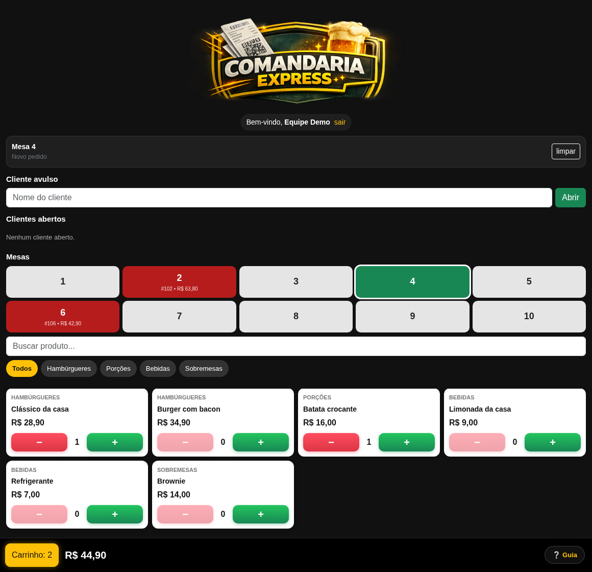
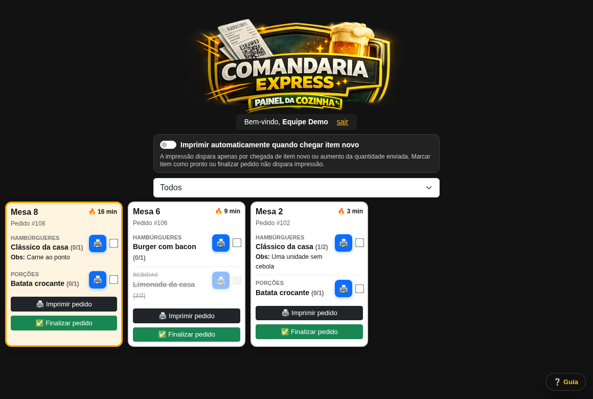
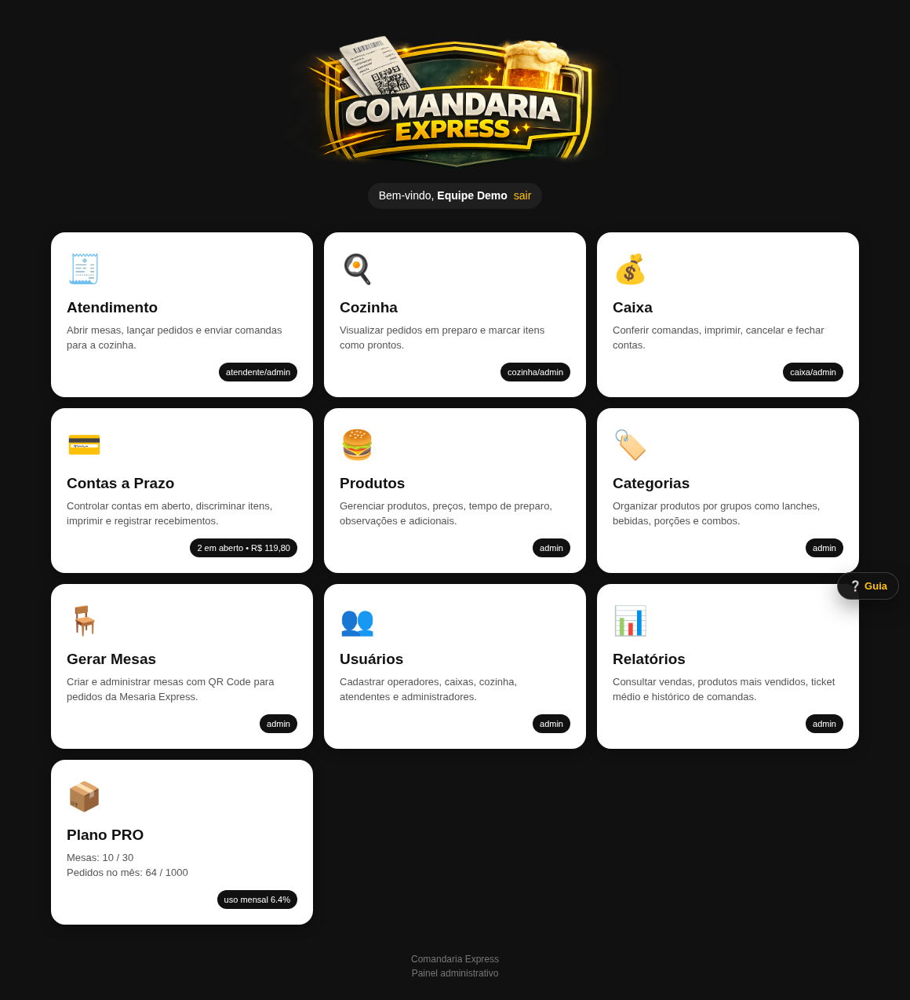
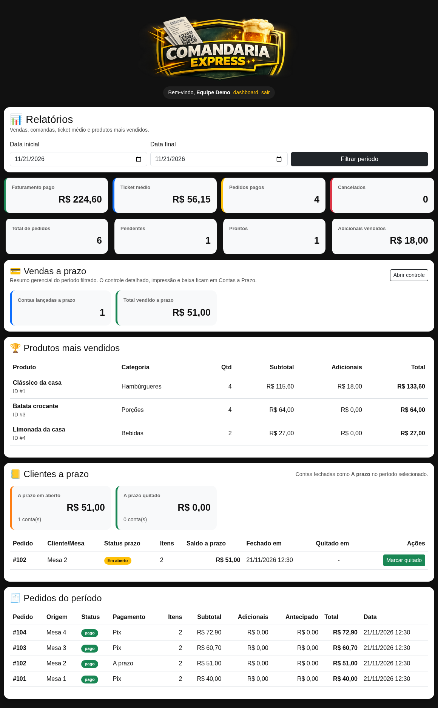
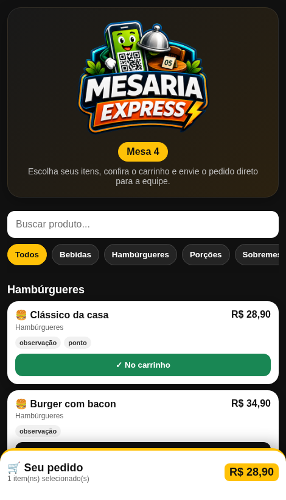
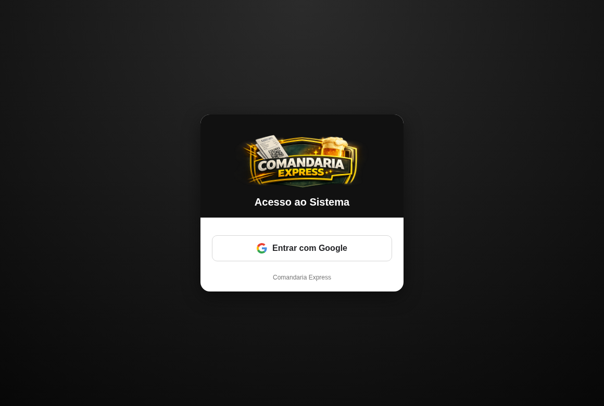

# Comandaria Express

Sistema de comandas para restaurantes, bares e lanchonetes. A equipe registra pedidos no atendimento ou recebe pedidos feitos pelo cliente via QR Code. A cozinha acompanha o preparo, e o caixa fecha a comanda.

## Telas do sistema

As capturas abaixo registram a interface anterior. Esta branch usa a paleta Bootstrap e títulos compactos.

Capturas da interface com dados fictícios.

### Atendimento



Selecione uma mesa ou abra uma comanda por cliente. O total fica ao lado do carrinho.

### Cozinha



### Dashboard



### Relatórios



### Pedido por QR Code e login

| Pedido por QR Code | Entrada da equipe |
| --- | --- |
|  |  |

## Fluxo de trabalho

1. **Administração.** Cadastre produtos e categorias, gere os QR Codes das mesas e consulte os relatórios. No plano Pro ativo, administradores também podem cadastrar usuários e atribuir perfis de atendimento, cozinha, caixa e administração.
2. **Atendimento.** Abra a comanda, selecione os produtos e registre observações, pontos ou adicionais quando disponíveis. O carrinho fica em destaque enquanto houver itens.
3. **Cozinha.** Acompanhe os pedidos recebidos, confira as observações e marque as quantidades preparadas.
4. **Caixa.** Consulte as comandas em aberto, registre pagamentos e acompanhe a abertura e o fechamento do caixa.

## Configuração

A aplicação usa PHP, MySQL ou MariaDB, JavaScript e Bootstrap. O login Google usa a biblioteca instalada pelo Composer.

1. Instale PHP com a extensão MySQLi e tenha o Composer disponível.
2. Execute na raiz do projeto:

   ```bash
   composer install
   ```

3. Configure as variáveis abaixo no ambiente do PHP. A instalação legada em `burguershake/` pode usar um ambiente próprio se estiver ligada a outro banco.

| Variável | Finalidade |
| --- | --- |
| `DB_HOST` | Host do banco. O padrão é `localhost`. |
| `DB_USER` | Usuário do banco. |
| `DB_PASSWORD` | Senha do banco. |
| `DB_NAME` | Nome do banco. |
| `GOOGLE_CLIENT_ID` e `GOOGLE_CLIENT_SECRET` | Credenciais OAuth para habilitar o login Google. |
| `GOOGLE_REDIRECT_URI` | URL opcional do callback OAuth. |

4. Em instalações existentes, aplique apenas as migrações pendentes. Para habilitar fotos dos produtos, importe uma vez `database/patch_fotos_produtos.sql` e cadastre a URL HTTPS da foto em **Produtos**.
5. Configure o servidor web com as regras de roteamento e proteção de `.htaccess`. Em uma instalação Apache usando essas regras, a entrada da equipe fica em `/login.php`.

### Banco novo

Para um banco vazio, selecione o banco configurado no passo 2 e importe, nesta ordem:

1. `database/schema.sql`
2. `database/migracao_multitenant_planos_google_19052026.sql`
3. `database/patch_servico_10_15052026.sql`
4. `sql/sql_onboarding_primeiro_acesso.sql`
5. `database/patch_admin_slug_comandaria_bacuri_19052026.sql`
6. `database/patch_limites_free_100_19052026.sql`
7. `database/patch_fotos_produtos.sql`

A estrutura inclui as permissões iniciais. Para o primeiro acesso, use **Entrar com Google** para o cadastro da empresa ou provisione um administrador com senha armazenada como hash PHP. As contas e os pedidos da instalação existente ficam no banco de origem.

## Estrutura do projeto

| Caminho | Conteúdo |
| --- | --- |
| `public/` | Telas, APIs e recursos da aplicação principal. |
| `core/` | Regras de pedidos, caixa, impressão, mesas e planos. |
| `config/` e `helpers/` | Configuração e utilitários PHP. |
| `database/` e `sql/` | Correções e scripts SQL auxiliares. |
| `burguershake/` | Variante legada da aplicação. |
